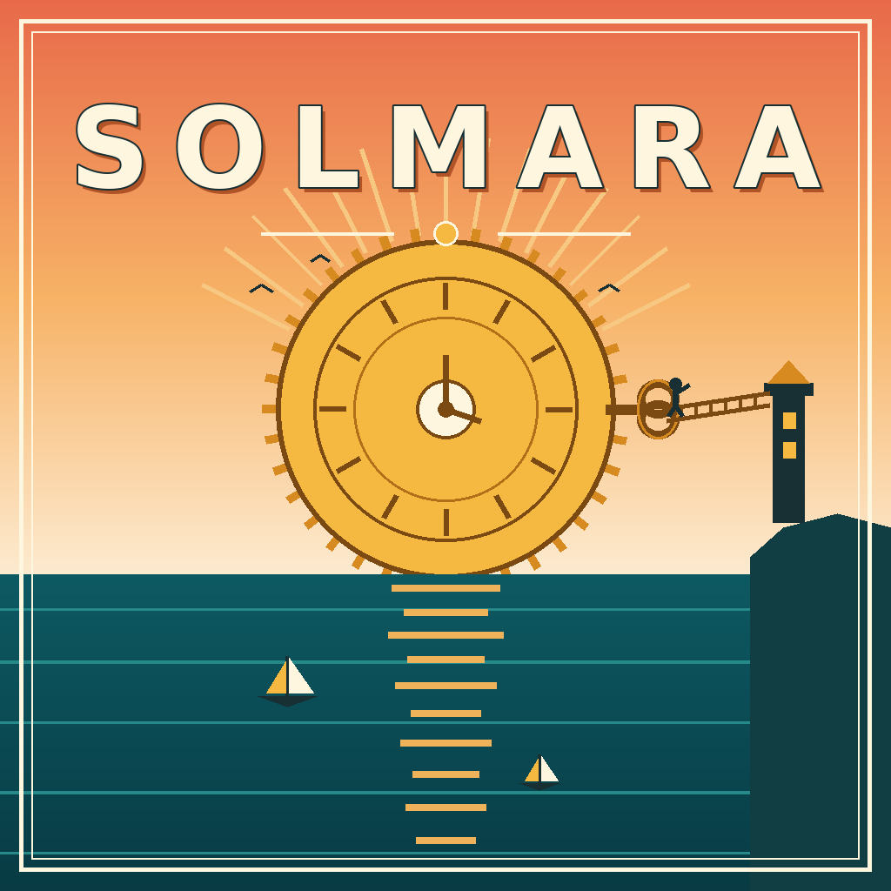

# Winding the Sun at Solmara

A travel poster for a place that does not exist, built for the make.fun
bounty **"The Poster for a Place That Isn't There"**
(`the-poster-for-a-place-that-i-2-20261121-0539`).

## The poster

**SOLMARA — the bay where the sun is wound by hand.** A small cliff-top
bay town at golden dawn. One landmark: the great brass sun, low over the
bay, built like a clockwork — gear teeth around its rim, a clock face in
its centre. A winding tower stands on the cliff, and a tiny keeper on a
ladder turns a huge brass key in the sun's side. Calm teal sea, a gold
path of light on the water, small sailboats, a few gulls.

The only text in the image is the invented place name, **SOLMARA**, set
large across the upper sky in letterspaced cream type — the poster's type
carries the mood, not an afterthought. No quotes, no star ratings, no
other copy.

Style: vintage art-deco travel poster, flat vector shapes, clean.
Palette: deep teal sea, warm gold sun, coral/peach dawn sky, cream type.
Layout: name across the upper sky, sun and winding tower in the centre,
horizon in the lower third, the eye travelling from name to landmark to
horizon.

## How it differs from the top winners

The closest similar bounty (`coolest-art-01`, 2,631 entries) is won by
one small human action performed on one vast natural wonder — 24 of the
top 50 titles begin with a verb, 19 use a craft verb, 23 name sea, moon
or tide. This entry takes the verb-led, one-action-one-wonder structure
but changes every detail: no moon, no aurora, no sea-knitting. The
wonder is the sun itself, treated as a wound brass clockwork object, and
the action is *winding* — a verb that appears in zero top-50 titles.
And unlike the art-bounty winners, this is a named invented place in
true travel-poster format, built for this judge brief: name, landmark
and a weather/light promise (golden dawn, calm warm bay) that say what
a stay there would feel like.

## How it works

- `draw_poster.py` — the generator. Draws the poster procedurally with
  PIL at 1024x1024: sky gradient, clockwork sun, winding key, ladder,
  keeper, tower, cliff, sea, boats, gulls, and the SOLMARA lettering.
  Fully deterministic: fixed palette and geometry, no randomness, no
  network, no clock. Re-running it reproduces the same `entry.png`.
- `main.py` — the entry program (Python 3 stdlib only, no network).
  Copies the bundled `entry.png` byte-for-byte to
  `$MAKEFUN_OUTPUT_DIR/entry.png` (default `/output`), then self-checks
  that the written file matches the source in size and SHA-256.
- `entry.png` — the poster itself (1024x1024 PNG).

## Verification

- `entry.png`: 1024x1024 px, PNG, **51,626 bytes** (limit 1,048,576).
- `main.py` run twice into separate output dirs: both outputs byte-identical.
- SHA-256 (both runs, and the bundled file):
  `0332e7f098be0a220d30562560edd2cced907624dac721805c187c2cd60d4886`
- Image viewed and checked by eye: name clearly readable, sun / keeper /
  tower read instantly, poster reads as a real vintage travel poster.

## Licence

MIT — see [LICENSE](LICENSE).
